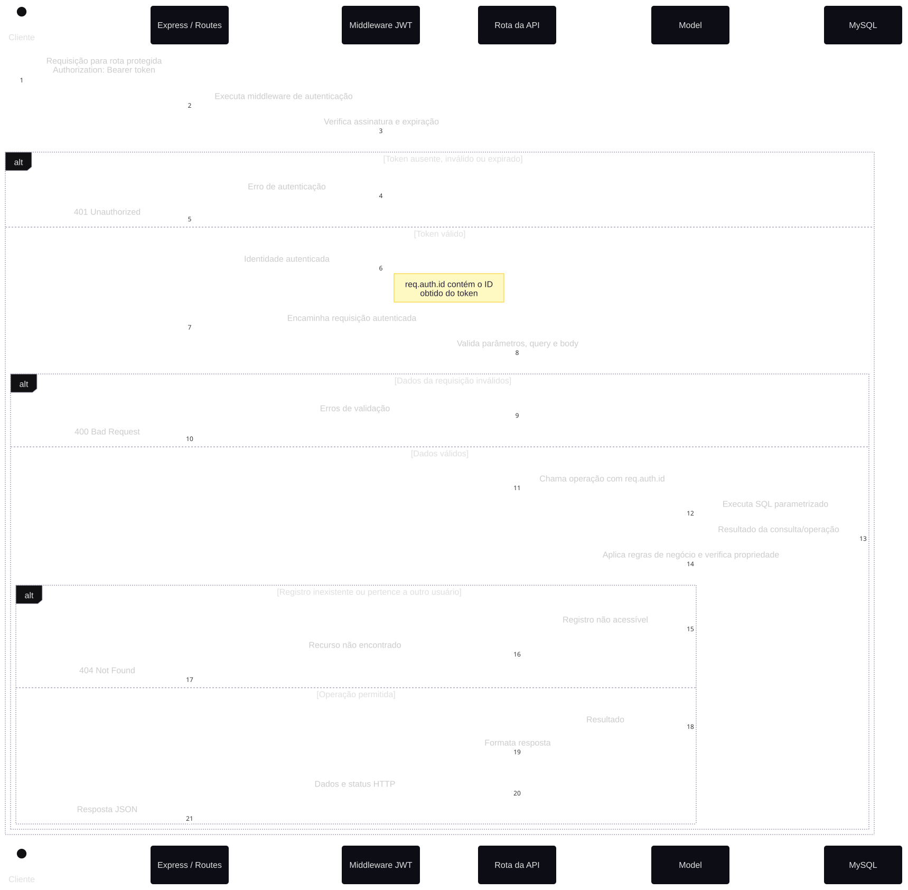

# API de Controle Financeiro

API REST para gerenciamento de finanças pessoais, desenvolvida como projeto avaliativo da disciplina **Programação Web Back-end**.

Aqui está o [link](https://costasilvati.github.io/IntroNodeJS/projeto-api-financas.html) da página de instruções feita pela professora.

O sistema permite cadastrar usuários, gerenciar categorias, fontes e destinos financeiros, registrar movimentações e gerar relatórios financeiros.

## Tecnologias

- Node.js
- Express
- MySQL
- mysql2
- JWT (jsonwebtoken e express-jwt)
- bcrypt
- dotenv
- nodemon

## Organização do projeto

```text
api-financas/
├── database/
│   ├── connection.js
│   ├── schema.sql
│   └── seed.sql
├── Docs/
│   ├── api_authentication_flow
│   ├── Sequencia_Cadastro_Auth
│   └── Sequencia_Rotas_Protegidas
├── middleware/
│   └── auth.js
├── models/
│   ├── Usuario.js
│   ├── Categoria.js
│   ├── FonteDestino.js
│   ├── Lancamento.js
│   └── Relatorio.js
├── routes/
│   ├── auth.js
│   ├── categorias.js
│   ├── fontesDestinos.js
│   ├── lancamentos.js
│   └── relatorios.js
├── utils/
│   ├── cpf.js
│   ├── parcelas.js
│   └── faturas.js
├── testes/
│   └── requisicoes.md
├── .env.example
├── .gitignore
├── package.json
├── README.md
└── server.js
```

## Divisão de responsabilidades

O desenvolvimento será realizado por três integrantes, utilizando divisão por domínio. Cada integrante será responsável pelo desenvolvimento completo de suas funcionalidades, incluindo banco de dados, models, consultas SQL, rotas e validações.

## Diagramas do Projeto

Esta seção apresenta os diagramas utilizados para documentar a estrutura do banco de dados e o fluxo de funcionamento da API.

<details><summary><b>Clique aqui para expandir a seção</b></summary>

### Diagrama Entidade-Relacionamento (DER)

Representa as entidades do sistema, seus atributos, chaves primárias, chaves estrangeiras e relacionamentos entre as tabelas.

<details><summary><b>Clique aqui para expandir a imagem</b></summary>



</details>

### Diagramas de Sequência

#### Cadastro e Autenticação

Representa o fluxo de cadastro de usuários, incluindo validações, criptografia de senha e criação dos registros iniciais, além do processo de autenticação e geração do token JWT.

<details><summary><b>Clique aqui para expandir a imagem</b></summary>



</details>

#### Rotas Protegidas

Representa o fluxo de acesso às rotas protegidas da API, desde o envio do token JWT até a validação da autenticação, identificação do usuário e execução das operações nos modelos e no banco de dados.

<details><summary><b>Clique aqui para expandir a imagem</b></summary>



</details>

</details>

### Integrante A — Usuários, autenticação e categorias

- Cadastro e autenticação de usuários.
- Hash de senhas com bcrypt.
- Geração e validação de JWT.
- Middleware de autenticação.
- CRUD de categorias.
- Relatório por categoria.
- Validação de CPF.

### Integrante B — Fontes e destinos

- Modelagem e gerenciamento de fontes e destinos.
- CRUD de fontes e destinos.
- Validações de contas, rendas e cartões de crédito.
- Relatório por fonte/destino.

### Integrante C — Lançamentos e faturas

- Modelagem e gerenciamento de lançamentos.
- CRUD de lançamentos.
- Filtros e paginação.
- Resumo financeiro.
- Compras parceladas.
- Previsão de faturas de cartão de crédito.

### Responsabilidades compartilhadas

- Estrutura inicial e configuração do projeto.
- Integração dos módulos.
- Consolidação do banco de dados.
- Dados para demonstração (`seed.sql`).
- Testes de integração.
- Documentação e apresentação.

## Instalação e execução

### 1. Clonar o repositório

```bash
git clone [URL_DO_REPOSITORIO](https://github.com/AzumaNoDoragon/projetoBackEnd)
cd projetoBackEnd
```

### 2. Instalar dependências

```bash
npm install
```

### 3. Configurar variáveis de ambiente

Copie `.env.example` para `.env` e configure as credenciais do MySQL e a chave secreta JWT.

### 4. Criar o banco de dados

Execute os scripts:

```text
database/schema.sql
database/seed.sql
```

### 5. Iniciar a aplicação

Desenvolvimento:

```bash
npm run dev
```

Execução normal:

```bash
npm start
```

## Organização do desenvolvimento

As atividades serão acompanhadas por meio do GitHub Issues e GitHub Projects.

- Cada funcionalidade terá uma Issue específica.
- As Issues serão atribuídas aos respectivos integrantes.
- Commits devem ser incrementais e descrever as alterações realizadas.
- As alterações serão integradas por Pull Requests.
- Funcionalidades concluídas deverão ser testadas antes de serem consideradas finalizadas.

## Regras de desenvolvimento

- Utilizar CommonJS (`require` e `module.exports`).
- Utilizar `express.Router()` para separar as rotas.
- Manter as consultas SQL exclusivamente em `models/`.
- Utilizar consultas parametrizadas no MySQL.
- Proteger as rotas privadas com JWT.
- Utilizar `req.auth.id` para identificar o usuário autenticado.
- Garantir que cada usuário tenha acesso somente aos próprios dados.
- Não versionar o arquivo `.env`.

## Escopo do projeto

O projeto deverá atender aos requisitos funcionais RF1 a RF9 do enunciado, incluindo autenticação, gerenciamento de dados financeiros, parcelamentos e relatórios.

O desafio de saúde financeira poderá ser desenvolvido como funcionalidade adicional.

## Disciplina

Programação Web Back End — Projeto 2
API de Controle Financeiro
